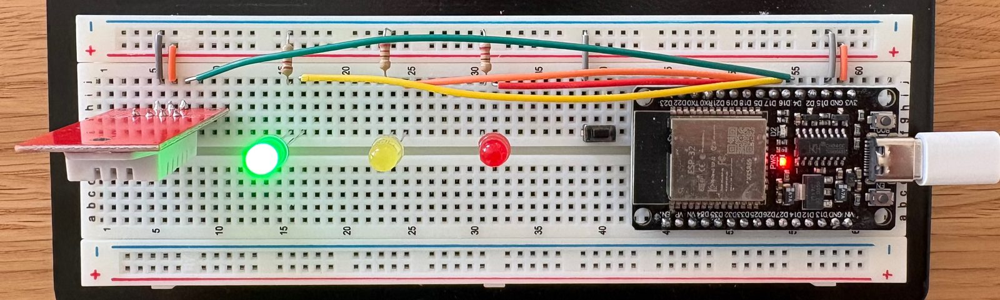
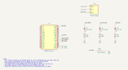

# env-monitor

An ESP32 with a DHT22 sensor measures temperature and humidity every 10 seconds and sends the readings over WiFi to a small Flask API. The API stores them in PostgreSQL, raises alarms when values leave their limits, and serves a live dashboard.

**Scenario:** a filament storage room needs temperature and humidity monitored continuously, with an alert when readings drift out of range, and with no data lost during network outages.

The scope is deliberately small: one sensor station, two measurements, one dashboard. The effort went into reliability (offline buffering, retries, idempotent writes, alarms with hysteresis) and into keeping each part simple enough to read in one sitting.

## Architecture

```
DHT22 ──> ESP32 (C++, Arduino) ──WiFi, HTTP JSON batches──> Flask API ──> PostgreSQL
            │  buffers in RAM while offline                     │
            │  evaluates alarms itself (LEDs)                   └──> dashboard (Chart.js)
            └─ fetches alarm limits and server time from the API
```

- **Firmware** (`firmware/`): reads the sensor, timestamps each reading in UTC, and sends it to the API. If the network or server is down, it keeps up to 12 hours of readings in RAM and resends them with exponential backoff. It evaluates the alarm limits itself, so the LEDs work without a connection.
- **API** (`server/app/`): validates batches, inserts them idempotently, evaluates alarms with hysteresis, and tracks when each station was last seen.
- **Database** (`server/db/init.sql`): four tables: `stations`, `readings`, `limits`, `alarms`.
- **Dashboard** (`/`): current values, a chart per sensor with the limits drawn in, recent alarms, and the online/offline status of each station. It refreshes every 10 seconds.

The details (API reference, schema, alarm rule, firmware timing and failure handling) are in [docs/design.md](docs/design.md).

## Quick start

### Server

Requirements: Docker Desktop. For the tests you also need [uv](https://docs.astral.sh/uv/).

```sh
cp .env.example .env    # then change both values in .env
docker compose up --build
```

- Dashboard: <http://localhost:5001/>.
- Database: `localhost:5432`, user and database `monitor`, password from `.env`. The port is published on `127.0.0.1` only, for tools such as Postico.
- `docker compose` refuses to start without `DB_PASSWORD` and `API_TOKEN` in `.env`. `DB_PASSWORD` only takes effect when the database volume is first created.

The alarm limits live in the database. Change them with SQL, and the firmware picks up the new values within a minute:

```sh
docker compose exec db psql -U monitor -d monitor \
  -c "UPDATE limits SET max_val = 60 WHERE sensor = 'humidity'"
```

### Firmware

Requirements: VS Code with the PlatformIO extension. Open `firmware/` as the PlatformIO project.

1. Copy `firmware/include/secrets.h.example` to `firmware/include/secrets.h` (gitignored) and fill in:
   - the WiFi name and password (the ESP32 supports **2.4 GHz only**),
   - `API_BASE_URL`: the computer's LAN IP with port 5001, e.g. `http://192.168.1.50:5001`,
   - `API_TOKEN`: the same value as in `.env`.
2. Upload and open the serial monitor: **Upload and Monitor** in the PlatformIO sidebar, or `pio run -t upload -t monitor` in `firmware/`. The VS Code extension does not put `pio` on the PATH; its CLI is `~/.platformio/penv/bin/pio`. Close any open serial monitor first, or the upload fails. The boot line shows when the running firmware was built.
3. If the macOS firewall is on, allow incoming connections for Docker (System Settings, Network, Firewall, Options). To check, open the dashboard from a phone on the same network.

## Hardware

- ESP32 DevKit V1 (ESP32-WROOM-32, CH340 USB chip)
- DHT22 module (3 pins, pull-up resistor on the module)
- green, yellow and red LEDs, each with a 220 Ω resistor
- a momentary pushbutton
- a full-size breadboard and jumper wires; no soldering

Power comes from USB only. The ESP32 runs at 3.3 V: never connect 5 V or more to a GPIO, the 3V3 pin or the sensor.

### Wiring

| Part | ESP32 pin | Notes |
|---|---|---|
| DHT22 VCC | 3V3 | never 5 V |
| DHT22 DATA | GPIO 4 (D4) | |
| DHT22 GND | GND | |
| Green LED | GPIO 16 (D16) | GPIO, LED anode (long leg), cathode (short leg), 220 Ω, GND |
| Yellow LED | GPIO 17 (D17) | same |
| Red LED | GPIO 18 (D18) | same |
| Pushbutton | GPIO 23 (D23) | other leg to GND; uses the internal pull-up |

On the breadboard the ESP32 covers all but one hole column, so only the pin row with 3V3 is reachable: 3V3, GND, D15, D2, D4, D16, D17, D5, D18, D19, D21, RX0, TX0, D22, D23 (USB end first). The pins above avoid the boot-related D15, D2 and D5 and the serial pins RX0/TX0. D21 and D22 stay free as the default I2C pins, in case the DHT22 is replaced by an I2C sensor.

The DHT22 module's middle pin is VCC, so a cable plugged in the wrong way round swaps power and ground. Check the orientation before powering it. Keep the DHT22 a few centimetres away from the ESP32, so the board's heat does not skew the readings.



The 3V3 and GND pins (right end) feed the upper power rails, which the DHT22 (left end), the LED resistors and the button use.

The same circuit as a schematic. The KiCad project is in [hardware/](hardware/); open `env-monitor.kicad_pro` in KiCad 10 or later.



### LEDs and button

| LED | Meaning |
|---|---|
| Green | the last send succeeded and no alarm is open |
| Yellow | WiFi down, sends failing (readings are being buffered), nothing sent yet since boot, or sensor fault |
| Red | at least one sensor has an open alarm; can be on together with yellow |

At boot, the three LEDs light once each (green, yellow, red) as a self-test.

The button triggers an immediate check: one reading, compared with the limits, logged on the serial monitor and sent like any other reading.

## Tests

```sh
./scripts/test.sh
```

The script starts a throwaway PostgreSQL on port 5433 (separate from the real database and from `.env`), runs the pytest suite, and removes the container afterwards. pytest arguments are passed through, e.g. `./scripts/test.sh -k alarms`.

The firmware has no automated tests. Each stage was tested on the board, including WiFi loss, server loss, a missing NTP server and an unplugged sensor. The scenarios are listed in [docs/design.md](docs/design.md#failure-handling).

## Repository layout

```
docker-compose.yml        API and database
docker-compose.test.yml   throwaway database for the tests
.env.example              template for the secrets in .env (gitignored)
scripts/test.sh           runs the server tests
server/
  app/                    Flask app: readings, limits, stations, alarms, dashboard
  db/init.sql             schema and seed data
  tests/                  pytest suite
firmware/
  include/config.h        pins, intervals, buffer size, timeouts
  include/secrets.h       WiFi, server URL, token (gitignored; see secrets.h.example)
  src/                    one module per concern (see docs/design.md)
hardware/                 KiCad schematic and the project's symbols
docs/
  design.md               API, database, alarm rule, firmware design, failure handling
  images/                 breadboard photo and schematic
```

This lists the main folders and the files you are most likely to look for, not every file.

## Design decisions

- **DHT22**: easy to get locally and simple to wire, with its pull-up on the module. Sensor access is isolated in one class (`EnvSensor`), so an I2C sensor such as a BME280 could replace it.
- **USB power only**: one cable, no regulator, nothing above 3.3 V on the breadboard.
- **Batches over HTTP**: one request can carry a whole backlog after an outage, and plain HTTP with JSON is easy to inspect with `curl`.
- **Idempotent inserts**: `UNIQUE (station_id, sensor, ts)` with `ON CONFLICT DO NOTHING`, so the firmware can resend whenever it is unsure, without creating duplicates.
- **Alarms with hysteresis**: the DHT22's humidity reading recovers slowly after a burst of moist air, so an alarm clears only once the value is back inside the limit by a margin. The firmware and server use the same rule.
- **Device time and server time stored separately**: `ts` is when the value was measured, `received_at` is when it arrived. Buffered readings keep their real time.
- **Flask**: widely used and small. FastAPI was considered, but the API is small enough to validate by hand, without a framework for it.
- **PostgreSQL in Docker from the start**, with plain parameterized SQL through psycopg 3 and no ORM.
- **Server-rendered dashboard**: one page with Chart.js, vendored, so it also works on a LAN without internet. It needs no JavaScript build step.

## Known limitations

This is a single-station demo on a home network. In particular:

- **Security:** plain HTTP, one shared API token, and an open dashboard: anyone on the LAN can view it.
- **Firmware buffer:** the buffer is in RAM, so a reset or power loss during an outage loses the buffered readings. Readings taken after boot but before the clock is set (usually the first 10–30 s) are skipped, because the server rejects timestamps before 2020.
- **Fault reporting:** sensor faults and button checks are visible on the device (yellow LED, serial log) but are not reported to the server, so the dashboard shows a sensor fault only as a gap in the chart.
- **Device alarm state:** the device's alarm state starts empty at every boot. Until the value leaves the hysteresis band, it can disagree with an alarm the server still has open.
- **Late readings:** a buffered reading that arrives after a newer one has cleared an alarm can open a new alarm with an older timestamp.
- **Sensor accuracy:** the DHT22 is a hobby sensor: about ±0.5 °C and ±2–5 % relative humidity.
- **Docker Desktop clock:** the VM clock can drift by a few seconds (seen after the Mac slept). This affects `received_at`, `last_seen` and the server time the firmware falls back to, not the measurement timestamps. Restarting Docker Desktop fixes it.

## What a production deployment would need

- **Database:** a dedicated schema instead of `public`, and a least-privilege role for the API, which currently connects as the image's superuser. Proper migrations instead of `init.sql`, which only runs on first start. Backups, and a retention or partitioning plan for `readings`.
- **API and devices:** TLS, per-device tokens stored as hashes instead of one shared token, authentication for the dashboard, and rate limiting.
- **Firmware:** OTA updates, flash-backed buffering, flash encryption (the WiFi password and token are currently readable from the flash), and reporting of sensor faults to the server.
- **Operations:** monitoring and alerting for stations that stop reporting, structured logging, and alarm notifications (for example a Telegram bot).

## License

MIT, see [LICENSE](LICENSE). The vendored Chart.js is also MIT-licensed; its license is in [server/app/static/vendor/](server/app/static/vendor/chart.js-LICENSE.md).
